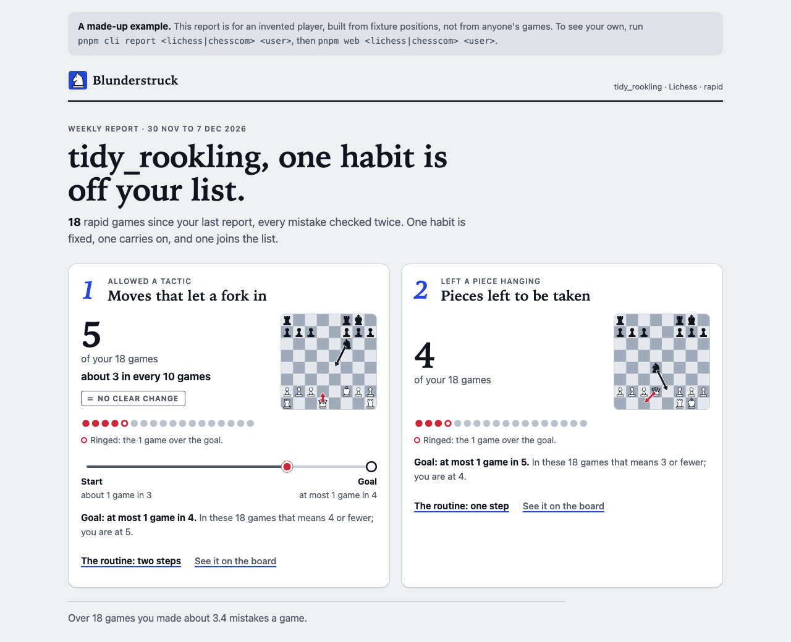

# Blunderstruck

Blunderstruck finds the chess mistakes you keep making across your games. It picks at most two
of them to work on, sized for your rating. Each later report shows whether they got rarer in
the games you played since.



([The same page in dark mode](docs/report-dark.png).)

## See it in one minute

You need Node 22.13 or newer and pnpm (`npm install -g pnpm`).

```bash
git clone https://github.com/priyanshujha/blunderstruck.git
cd blunderstruck
pnpm install
pnpm web --demo
```

Then open `http://127.0.0.1:4321/`. The demo is a made-up report for an invented player, held
in memory. It needs no Stockfish, no model key and no database. `--port` picks another port.

## Run it on your own games

1. **Install Stockfish.**
   - macOS: `brew install stockfish`
   - Debian or Ubuntu: `sudo apt install stockfish`
   - Windows: download Stockfish and set `STOCKFISH_PATH` to the program's full path.

   On any system, `stockfish` must be on your `PATH`, or `STOCKFISH_PATH` must name it.
2. **Make a report**, with your own username:

   ```bash
   pnpm cli report lichess <you>
   pnpm cli report chesscom <you>
   ```

3. **Read it in your browser** at `http://127.0.0.1:4321/`, reachable from this machine only:

   ```bash
   pnpm web lichess <you>
   ```

Chess.com and Lichess need no key or account.

**How long it takes.** Every move gets a quick first look. The moves that look like mistakes
are then checked again more deeply, at about 1.3 seconds a position on a laptop. A first report
on about 160 games took about half an hour. A first look at a sample is printed before the end.
Later runs only analyse the games played since, and a report rebuilt from stored analyses
takes seconds. Ctrl-C stops a run; the next run continues where it stopped.

**No model key needed.** Without one, the report has every number, the focus items and the
examples, with plain built-in wording. A key only lets a model write the words. To add one:

```bash
cp .env.example .env
```

Then set `ANTHROPIC_API_KEY` (Claude) or `GEMINI_API_KEY` (Gemini) in `.env`. If both are set,
Claude is used; `--provider anthropic|gemini|none` chooses. `pnpm -s cli models` prints which
model each provider uses. The model never chooses anything and never writes your numbers: it
writes placeholders that code fills in, and any move it names must be in your examples. A
report makes at most three model calls. Keys are read only from the environment or `.env`
(`--env <path>` reads another file). Keep `.env` out of folders that sync to other people.

Other optional settings are listed in `.env.example`: `BLUNDERSTRUCK_CONTACT` (sent to
Chess.com and Lichess in the User-Agent, as their API guidelines ask) and `LICHESS_TOKEN`
(raises Lichess's limits).

## What a report looks like

The start of the terminal report for the demo's invented player:

```
Weekly report for tidy_rookling (lichess, rapid)
Rating band: club, from your median rating of 1240 in these games
Period: 30 Nov to 7 Dec 2026
Games: 18 found, all analysed

Over 18 games you made about 3.4 mistakes a game.

Focus (2 things)
1. Moves that let a fork in [Allowed a tactic]
   In 5 of your 18 games a move of yours handed the other side something for free.
   In 5 of your 18 games, about 3 in every 10 games.
   Goal: at most 1 game in 4. In these 18 games that means 4 or fewer; you are at 5.
   It came up in 6 of your last 6 weeks. Kept from your last report (since 16 Nov).
   Looking at all 27 times in your last 96 games:
   - Their best reply gave check: 11 of your 27, against about 1 in 8 of your mistakes overall. 6 of them from the knight that moved.
   - The piece you had just moved was taken: 10 of your 27, against about 1 in 4 of your mistakes overall.
   The habit to build:
   1. Before you let go of the piece, find every check they would have, knight checks first.
   2. Look at the square you are moving to. Count what attacks the piece there and what guards it.
```

## What it measures, and what it does not

It measures moves that cost you a lot of winning chances, by Stockfish, and sorts them into
nine patterns: missed mate, allowed mate, hung piece, allowed tactic, missed capture, missed
tactic, thrown win, time trouble and opening trouble. Frequencies and goals are counted in
games. Each focus item shows its blind spots (what its mistakes have in common more often than
your mistakes overall), one practice step for each, and positions from your games. An example
says what your move allowed, the better move, and what the game played next. It states a cost
as fact only when the game really took what the move allowed.

It does not judge slow or positional play: most mistakes that are not a one-move tactic carry
no pattern. It uses rated bullet, blitz, rapid and classical games only, one time class per
report, never daily or correspondence games. One week of games is a small sample, so "no clear
change" is a common and honest answer.

## Your data

Everything is kept in one SQLite file, by default `~/.blunderstruck/blunderstruck.db`, outside
the repository. `--db <path>` or `BLUNDERSTRUCK_DB` puts it elsewhere. To back it up or move it:

```bash
pnpm cli db export backup.ndjson
pnpm cli db import backup.ndjson
```

The export refuses to overwrite a file unless you pass `--force`. Importing twice changes
nothing.

## Commands

All commands run from the repository root. `pnpm -s cli --help` prints every command and flag.

```
pnpm cli report <lichess|chesscom> <user> [--time-class <class>] [--depth 12] [--check-depth 18]
         [--db <path>] [--provider anthropic|gemini|none] [--env <path>] [--band <band>]
         [--as-of <ISO date>] [--now] [--sample-only] [--max-games N] [--json] [--all]
pnpm cli db export <file> [--db <path>] [--force] [--env <path>]
pnpm cli db import <file> [--db <path>] [--env <path>]
pnpm cli models
pnpm web <lichess|chesscom> <user> [--port 4321] [--db <path>] [--time-class <class>] [--env <path>]
pnpm web --demo [--port 4321]
```

The most useful `report` flags:

| Flag | Effect |
|---|---|
| `--time-class` | bullet, blitz, rapid or classical (default: the one used before, or the one you played most) |
| `--check-depth` | depth of the deeper check of likely mistakes (default 18; 0 turns it off: faster, noisier) |
| `--now` | make a new report even with fewer than 10 new games |
| `--sample-only` | stop after a sample of 150 games; a later run finishes the rest |
| `--max-games N` | analyse at most N of the period's games |
| `--json` | print the stored report as JSON |
| `--all` | also print the week-by-week table and every pattern's trend |

Lower-level commands work on a JSON file of games instead of the database: `fetch`, `analyze`,
`patterns` and `eval`. See `pnpm -s cli --help`.

How it all works is in [docs/architecture.md](docs/architecture.md).

## Licence

AGPL-3.0-only. You may run, change and self-host it. If you offer a modified version to
others over a network, you must publish your changes. Stockfish is a separate GPL-3.0 program
that Blunderstruck runs as its own process.

Contributions are welcome; see [CONTRIBUTING.md](CONTRIBUTING.md).
